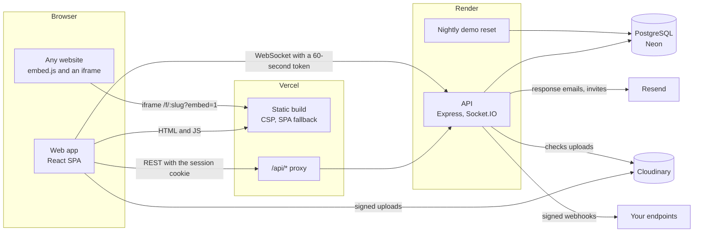

# Formyx

Formyx is a full-stack form builder in the spirit of Tally and Typeform. Build a form by dragging questions into place, show or hide questions with conditional logic, publish it as a link or embed it in any site, and watch responses arrive live with a summary of every question.

Forms are JSON documents validated by one shared Zod schema, rendered from that schema everywhere (editor canvas, preview, public page, embeds) and checked with the same rules in the browser and on the server.

**Try it:** the landing page's "Try the demo" signs you in to a shared workspace with three forms and a month of responses. No sign-up needed.

<!-- Screenshots and a GIF go in docs/images/. Replace each placeholder below with the image. -->

| Editor                                             | Responses                                             | Public form                                             |
| -------------------------------------------------- | ----------------------------------------------------- | ------------------------------------------------------- |
| _Screenshot placeholder: `docs/images/editor.png`_ | _Screenshot placeholder: `docs/images/responses.png`_ | _Screenshot placeholder: `docs/images/public-form.png`_ |

_GIF placeholder: `docs/images/live-responses.gif`, a form being filled in on a phone while the response appears on the dashboard._

## Features

- **Editor.** Drag and drop questions (mouse, touch and keyboard), 28 question types and 5 content blocks, pages, hidden fields, templates, undo and redo, autosave with conflict detection, keyboard shortcuts, and a tabbed layout on small screens.
- **Conditional logic.** Show a question only when earlier answers match, with comparisons that fit each question type, combined with all or any.
- **Advanced logic.** Pages with titles, jumps after a page ("if … go to page X or end screen Y"), a read-only map of pages and jumps that warns about unreachable pages, answers and values piped into text (`Thanks, {{name}}!`), calculated values (score, price, custom), quiz mode with points, a pass mark and an optional answer review, several designable end screens with redirects, shuffled questions and options, and answers saved in the browser or emailed as a link to finish later.
- **Themes.** Presets, layered backgrounds (gradients, mesh gradients, textures, shapes, images), 40 open-licence fonts with pairings, input, choice, button and container styles, question numbers, progress bars, and classic, card, split or one-question-at-a-time layouts. Brand kits carry a workspace's logo, colours and fonts from form to form, and a look can be suggested from a logo. One renderer draws the editor canvas, preview, public form and embeds, so they always match. Changes publish with the form.
- **Plans.** Free, Pro and Business entitlements, checked through shared helpers. Everything is unlocked during the beta; when enforced, anyone can try Pro styles in the editor, but publishing them needs Pro.
- **Publishing.** Drafts stay private until published; respondents always see the last published snapshot. Share a link, a QR code in the form's colours, a prefilled link or an embed snippet; close and reopen forms.
- **Settings.** One page per form with a section nav, search and a save status: passwords, one response per browser or per confirmed email address (a 6-digit code), asking for respondents' email, opening and closing times with a closed message, a response limit, private links to change a response, unlisted or listed in search engines; the form's language (English, Telugu or Hindi, for buttons, checks and dates), date and number formats, progress bar, question numbers and required markers; notification emails to other addresses, Slack and Discord, and daily digests; an autoresponder with piped answers, a preview and a test send; a custom address, link previews and favicon; automatic deletion of old responses, CSV and Excel downloads and deleting every response. Access settings apply at once; the form's own settings publish with it.
- **Preferences.** Each person chooses the app's theme and motion (saved to their account), the language of their new forms, response emails, and can change their password or delete their account. Each workspace has a time zone, a date format, default notifications and a default brand kit.
- **Embeds.** One `<script>` and a `<div>` put a form in any page. It resizes itself and tells the page when someone submits.
- **Responses.** A live summary (views, completion rate, time to complete, responses per day, a drop-off funnel, per-question charts), a searchable table, a detail view with each response's end screen, quiz mark and values, bulk delete, CSV and Excel export, and responses changed by their respondents updating live.
- **Live updates.** New responses appear on the dashboard as they arrive, over Socket.IO.
- **Teams.** Workspaces with owner, editor and viewer roles, and email invites.
- **Integrations.** An Integrations page per form: Google Sheets (a row per response, kept in step as responses arrive and change), Notion (a typed database), Slack and Discord (formatted messages with a link to the response), and signed webhooks, each with its status, last error and a reconnect flow, plus failed jobs to retry. Response emails go through Resend and uploads straight to Cloudinary.
- **Background jobs.** Webhooks, response emails, chat posts, integrations and hourly upkeep run as durable jobs in Postgres (pg-boss) with retries and backoff.
- **Quality.** Light and dark modes, WCAG 2.2 AA checked with axe, reduced motion respected, and a public form that loads in under a second on desktop.

## Architecture



| Package           | What                                                                                                                                                |
| ----------------- | --------------------------------------------------------------------------------------------------------------------------------------------------- |
| `apps/web`        | React 18, Vite, TypeScript, Tailwind CSS v4, shadcn/ui (Radix), React Router, TanStack Query and Table, React Hook Form, Recharts, Socket.IO client |
| `apps/api`        | Node.js, Express 5, TypeScript, Prisma 7 + PostgreSQL, Zod, pino, Socket.IO, Resend, Cloudinary                                                     |
| `packages/shared` | Zod schemas, types and pure logic shared by web and api: the form schema, validation, conditional logic, analytics                                  |
| `e2e`             | Playwright end-to-end and accessibility tests                                                                                                       |

## Key decisions and trade-offs

**Forms are JSON documents, not tables of questions.** A form's questions, logic and settings are one `FormSchema` document (a `jsonb` column) validated by a Zod schema in `packages/shared`. The builder edits it, the renderer draws it and the validator reads it, so a new question type is a change to one schema and a few components, not a migration. The document carries a `version` for future changes to its shape. The cost: the database cannot query individual questions, so per-question analytics fold responses in application code, in batches of 1,000.

**Draft and published snapshot.** Editors change `draftSchema`; publishing copies it to `publishedSchema` (and the theme and title alongside). Respondents only ever see the snapshot, so a half-finished edit can never break a live form, and every response is validated against exactly what the respondent saw. Answers are keyed by question id, so renaming a question keeps its answers together. The cost is a second copy per form and an explicit "Publish" step, which the editor makes visible with an "Unpublished changes" state.

**One validation, in the browser and on the server.** `evaluateVisibility`, `buildSubmissionValidator` and `sanitizeAnswers` decide which questions show and what may be sent. The public form uses them for instant feedback; the API runs the same code as the authority. Hidden questions never count as required and their answers are dropped, so conditional logic cannot be bypassed by a crafted request. The shared package stays pure and browser-safe, and Zod runs `jitless` in the browser, which is faster to start and works under a strict content security policy.

**Optimistic concurrency instead of locks.** Every draft write sends the `version` it started from; a stale one gets `409 CONFLICT`. Two people editing the same form never overwrite each other silently. There is no live co-editing: the second editor is asked to load the latest version.

**First-party cookies, short-lived socket tokens.** Sessions are httpOnly, `SameSite=Lax` cookies. In production Vercel proxies `/api/*` to the API, so the cookie belongs to the site itself and third-party cookie blocking never applies. Vercel cannot proxy WebSockets, so the live-updates socket connects to the API directly, where the cookie is not sent. Instead, the page asks `GET /api/realtime/token` (through the proxy, with the cookie) for a 60-second token with its own issuer and audience, and hands it over in the handshake. Socket tokens are refused as sessions and sessions are refused by the socket. The cost is one extra request per connection.

**Signed webhooks.** Each webhook has its own secret, shown once and stored encrypted (AES-256-GCM). Every delivery carries `X-Formyx-Signature: sha256=<HMAC of the raw body>`, so receivers can check it came from Formyx and was not changed; retries reuse the same body and signature. URLs must be public `https` addresses, checked again at connection time against the resolved IP, so webhooks cannot reach private networks.

**Jobs in Postgres, not Redis.** Background work is queued with pg-boss in the database the app already has: no new service, jobs survive restarts and are shared between instances. pg-boss's own timers are off and a small loop polls instead: every second while there is work, then not at all until a job is sent or a delayed one (a retry, the next hourly upkeep) comes due, so a quiet site sends Neon no queries and its compute can suspend.

**The server decides outcomes.** Navigation, calculations, quiz marking and the choice of end screen are pure functions in `packages/shared/src/logic`. The browser runs them to show the route and piped values as people answer; the server runs them again on every submission and stores the result. Correct quiz answers never leave the server (`toPublicSchema` strips them), so the browser cannot mark a quiz, and totals sent by a client are never read. The cost: an end screen that depends on the quiz mark waits for the server's reply, which it does anyway.

**The public form is its own small bundle.** Respondents download 205 KB (gzip) with no editor, dashboard or chart code; an ESLint rule keeps those imports out and CI fails if the bundle grows past its 205 KB budget. The conversational flow, font files and their loaders arrive only when a form needs them. Embeds load the same page in an iframe, which isolates the form's styles and scripts from the host page; the two talk over `postMessage` with origin and source checks.

**One shared demo account.** "Try the demo" signs everyone in to the same account, reset every night, rather than creating a sandbox per visitor. It costs nothing per visit and the data always looks lived-in. Anything that would reach outside Formyx (emails, invites, webhooks, uploads) or change the workspace itself is refused for that account.

**One API instance.** Rate limits and Socket.IO rooms live in memory. That keeps the stack to two services and a database; running several API instances needs Redis (rate limit store, Socket.IO adapter). The job queue is already shared (see above), and `WORKERS=off` with `pnpm --filter @formyx/api jobs:worker` moves jobs to a process of their own.

## Getting started

Requirements: Node.js 22.13+, pnpm (the exact version is pinned in `package.json`) and PostgreSQL 17 (see [Database](#database)).

```sh
pnpm install

cp apps/api/.env.example apps/api/.env
# Then set JWT_SECRET in apps/api/.env (the file explains how to generate one).
cp apps/web/.env.example apps/web/.env   # optional

pnpm db:up        # start Postgres in Docker (skip if you run Postgres yourself)
pnpm db:migrate   # create the tables

pnpm dev
```

- Web: http://localhost:5173 (proxies `/api` to the API)
- API: http://localhost:4000, health check at `/api/health`
- Styleguide (development only): http://localhost:5173/styleguide

To try the demo locally, set `DEMO_ENABLED=true` in `apps/api/.env` and `VITE_DEMO_ENABLED=true` in `apps/web/.env`, restart `pnpm dev`, and use "Try the demo" on the landing page. `pnpm --filter @formyx/api db:seed:demo` resets the demo account at any time.

## Tests

| Command                          | Runs                                                                                                                                             |
| -------------------------------- | ------------------------------------------------------------------------------------------------------------------------------------------------ |
| `pnpm test`                      | Vitest in every package: shared logic, API routes against a real Postgres (Supertest), and web components (React Testing Library)                |
| `pnpm test:e2e`                  | Playwright on desktop and phone viewports: sign-up to CSV export, the editor, logic, publishing, live responses, teams, themes, webhooks, embeds |
| `pnpm --filter @formyx/web size` | The gzip size of every route, failing if the public form passes its budget                                                                       |

- API tests need the `formyx_test` database (see [Database](#database)); every run empties it, and the setup refuses any database whose name does not end in `_test`.
- `e2e/tests/journey.spec.ts` is the whole story in one test: sign up, create a form from a template, add a question with a condition, publish, answer the form as a respondent on a phone in a second browser, see the response arrive live, and export it as CSV.
- `e2e/tests/accessibility.spec.ts` runs axe (WCAG 2.2 A and AA) on the landing page, dashboard, editor and public form, in light and dark mode, and fails on any serious or critical issue.
- `e2e/tests/embed.spec.ts` embeds a form in a page served from another origin and checks resizing and the `formyx:submitted` event.
- `e2e/tests/new-fields.spec.ts` fills in a three-page form with every newer question type, including a typed signature, a voice note recorded from Chromium's fake microphone and the PIN look-up, and checks the stored answers and the response drawer. `e2e/scripts/fake-cloudinary.mjs` stands in for Cloudinary and India Post (Playwright starts it), so the tests make no outside calls.
- `e2e/tests/logic.spec.ts` takes a quiz with a jump to an end screen as three respondents, checks the server's mark, a redirect carrying an answer and the drop-off funnel, then saves answers in the browser and by an emailed link, and finishes the form from the link in another browser.
- To run the tests beside dev servers on the usual ports, move them: `E2E_WEB_PORT`, `E2E_API_PORT` and `E2E_FAKE_PORT` (defaults 5173, 4000 and 4590).
- Before the first `pnpm test:e2e`, install the browser once with `pnpm --filter @formyx/e2e exec playwright install chromium`. End-to-end tests sign up throwaway users in the development database, and reuse dev servers that are already running.

CI (`.github/workflows/ci.yml`) runs formatting, lint, typecheck, unit and API tests, the build and the size check, then the end-to-end tests, on every pull request.

## Deployment

The web app goes to **Vercel**, the API to **Render** and the database to **Neon**. Resend (email) and Cloudinary (uploads) are optional: without them emails are logged and uploads are switched off.

### 1. Database: Neon

Create a Neon project and copy two connection strings from its dashboard: the **pooled** one (its host contains `-pooler`) for `DATABASE_URL`, and the **direct** one for `DIRECT_URL`, which migrations use. Both include `sslmode=require`.

### 2. API: Render

1. In Render, choose **New > Blueprint** and pick this repository. `render.yaml` creates the `formyx-api` web service (which also runs background jobs, the hourly upkeep included), a `formyx-demo-reset` cron job (03:00 UTC every night) and a `formyx-database` environment group they share. Set `ENCRYPTION_KEYS` (`pnpm --filter @formyx/api keys:new` makes one) before connecting any integration, and keep it safe: without it, stored tokens and secrets can't be opened.
2. Fill in the values Render asks for: `DATABASE_URL` and `DIRECT_URL` in the group; `CORS_ORIGIN` and `APP_URL` (your Vercel address, which you can add after step 3); and, optionally, `RESEND_API_KEY`, `EMAIL_FROM` and the three `CLOUDINARY_*` values. `JWT_SECRET` is generated for you.
3. Every deploy builds `packages/shared` and the API, runs `prisma migrate deploy` (the pre-deploy command; a failed migration stops the deploy and the previous version keeps running), then starts the server. Render waits for `/api/health` before sending traffic.

Pre-deploy commands and cron jobs need a paid instance type. On the free plan, start the API with `pnpm --filter @formyx/api db:deploy && pnpm --filter @formyx/api start` instead, and reset the demo from somewhere else (for example a nightly GitHub Actions job running `pnpm --filter @formyx/api db:seed:demo` with `DATABASE_URL` as a secret). Free instances sleep when idle, so the first request after a while is slow, and background jobs wait while it sleeps: they run when it wakes, in order, none lost. To keep digests on time on the free plan, call `pnpm --filter @formyx/api jobs` hourly from a GitHub Actions schedule (with the API's environment as secrets); it is safe to run twice or late.

### 3. Web: Vercel

1. Import the repository in Vercel and set the **Root Directory** to `apps/web`. `apps/web/vercel.json` sets the install and build commands.
2. Add the environment variables:

   | Variable                       | Value                                                             |
   | ------------------------------ | ----------------------------------------------------------------- |
   | `API_URL`                      | The Render service, e.g. `https://formyx-api.onrender.com`        |
   | `VITE_REALTIME_URL`            | The same address: the live-updates socket connects there directly |
   | `VITE_APP_URL`                 | This site's address, for link previews (Open Graph tags)          |
   | `VITE_DEMO_ENABLED`            | `true` to show "Try the demo"                                     |
   | `ENABLE_EXPERIMENTAL_COREPACK` | `1`, so Vercel uses the pnpm version pinned in `package.json`     |

3. Deploy. On Vercel the build also writes [Build Output API](https://vercel.com/docs/build-output-api/v3) files (`apps/web/build/vercel-output.ts`):
   - `/api/*` is proxied to `API_URL`, so the session cookie is first-party;
   - every other unknown path serves the app, which handles routing and its own 404 page;
   - a content security policy allows only the site's own scripts (inline ones by hash), its API, the socket and Cloudinary uploads;
   - public forms (`/f/*`) may be embedded anywhere (`frame-ancestors *`), every other page refuses to be framed;
   - hashed assets are cached for a year, `embed.js` for five minutes.

Public form pages (`/f/:slug`) go through a small edge function (`apps/web/build/form-meta-edge.ts`, written into the Vercel output at build time). It asks the API for the form's title, description, preview image, favicon and whether it may be indexed, writes them into the page's `<head>` for link previews and search engines, and redirects old addresses. If the API takes more than 1.5 seconds, the page goes out as it is. `pnpm dev` does the same through a Vite plugin.

### 4. Connect them

Set `CORS_ORIGIN` and `APP_URL` on Render to the Vercel address (add a custom domain to `CORS_ORIGIN` with a comma) and redeploy the API. Then open the site, sign up, publish a form, answer it in a private window and check that the response appears live.

### Notes

- **Client IPs.** Requests reach the API through Vercel's proxy and then Render's load balancer, so `render.yaml` sets `TRUST_PROXY=2` and rate limits see the visitor's IP. The API's own address is public (the socket needs it), and a request sent there directly could claim any IP in `X-Forwarded-For`, which weakens per-IP rate limits for such requests. Closing this needs the proxy to sign a header the API trusts (see the roadmap).
- **Migrations** are plain SQL in `apps/api/prisma/migrations`, applied in order by `prisma migrate deploy`. Write them to work with the previous version of the code still running.
- **Stored formats.** Themes and form schemas are JSON with a version. The API upgrades older ones as it reads them, so a deploy never waits on data. To rewrite them in the current format afterwards (theme v2 arrived in Sprint 9), run `pnpm --filter @formyx/api forms:migrate -- --dry-run` from the Render shell, then without `--dry-run`. It only touches forms that need it, never overwrites a save made while it runs, and leaves `updated_at` alone. A second run changes nothing.
- **Plans.** `ENTITLEMENTS_MODE=all_unlocked` (set in `render.yaml`) gives every workspace every feature. Switch it to `enforced` once plans are sold.
- **Secrets.** Never commit `.env` files; `.env.example` lists every variable. Changing `JWT_SECRET` signs everyone out and makes stored webhook secrets unreadable, so webhooks would need adding again.

## Roadmap

- **Server-render or prerender public forms.** Desktop Lighthouse scores 99 for performance, but on a simulated slow phone the client-rendered page scores 75 to 83, because nothing shows until JavaScript runs. Rendering the form's HTML on the server would bring first paint forward by about two seconds.
- **Several API instances**: Redis for rate limits and the Socket.IO adapter.
- **A signed header from the proxy**, so the API trusts forwarded client IPs only from Vercel.
- **Partial responses**: keeping the answers of visits that never send, beside the drop-off counts.
- **Payments.**
- **Backward jumps** (loops), with a guard against endless routes; jumps only go forward for now.
- **Custom domains** for public forms, and translations of a form.
- **Live co-editing** in the editor, building on the existing Socket.IO rooms.

## Embedding

Share › Embed gives a snippet for any page:

```html
<div data-formyx="customer-survey-x7k2p9q1"></div>
<script src="https://formyx.app/embed.js" async></script>
```

`embed.js` (about 1 KB gzipped, no dependencies) replaces each `[data-formyx]` element with an iframe of `/f/:slug?embed=1`. In embed mode the form drops the page background and footer and becomes a card. The iframe reports its height and title with `postMessage`; the script only accepts messages from its own origin and from that iframe, and resizes it. When someone submits, the element dispatches a bubbling `formyx:submitted` event with `{ detail: { slug } }`. Elements added later can be mounted with `window.Formyx.scan()`. The host page's query string is passed on to the form, to fill hidden fields, and the iframe may use the microphone, for voice notes. `examples/embed-demo.html` is a page to try it with.

## Demo account

`POST /api/auth/demo` (when the API has `DEMO_ENABLED=true`) signs in to the shared demo account, setting it up on first use. Its data comes from `apps/api/src/demo`: three published forms (product feedback, an event registration and a job application, each with its own theme) and 150 responses over the last 30 days, busier on weekdays and with the spikes you would expect (a newsletter, an announcement, a job posting tailing off). The data is generated from a fixed seed, every answer passes the same validator as real responses, and names, emails and phone numbers use reserved example domains and fictional number ranges.

- **Reset.** `pnpm --filter @formyx/api db:seed:demo` (or `demo:reset` after a build) puts everything back in one transaction. The account and workspace keep their ids, so visitors who are signed in stay signed in.
- **Limits.** The demo account has no password and cannot log in with one. Invites, member and workspace changes, webhooks, response emails and uploads (including respondents' files on demo forms) are refused with `403 DEMO_RESTRICTED`, and the app shows a banner saying so. Forms and responses can be changed freely until the next reset.

## Performance

| Route                  | JS + CSS (KB, gzip) |
| ---------------------- | ------------------- |
| Public form `/f/:slug` | 205                 |
| Landing                | 208                 |
| Forms dashboard        | 270                 |
| Responses              | 297                 |
| Editor                 | 397                 |

`pnpm --filter @formyx/web size` prints these after a build, and CI fails if the public form passes its 205 KB budget (raised from 190 KB in Sprint 11 for forty fonts, choice and button styles and progress bars, to 200 KB in Sprint 12 for the new question types, and to 205 KB in Sprint 13 for pages, jumps, piping, shuffling and saved progress; it measures 204.8 KB). End screens, saving by email, resuming from a link and the browser's own quiz marking load only when needed, and the checks that span a whole form schema (`formSchema`) stay out: the public form reads published forms with `formSchemaShape`, since the server checked them when they were published. The controls for newer question types, file uploads, image and video blocks and the phone country table load only with forms that use them. The Design Studio, presets, brand kits and readability checks load only in the editor; a form's fonts, their loaders, resized fallbacks and photo textures load only when a form uses them, and the conversational flow only for conversational forms (the public page loads it behind the skeleton, so it never pops in).

Lighthouse on the public form, served from a production build: **99** performance, **100** accessibility, **100** best practices and **100** SEO on desktop (first contentful paint 0.7 s, no layout shift). On Lighthouse's simulated slow 4G phone, performance is **75 to 83** and the other three stay at 100.

With the busiest presets (Sprint 10, median of three runs, local production build served without compression):

| Preset         | What it draws                                      | Desktop | Phone | CLS |
| -------------- | -------------------------------------------------- | ------- | ----- | --- |
| Minimal        | One solid colour                                   | 99      | 84    | 0   |
| Confetti party | 28 SVG shapes, a card with a shadow, Nunito        | 99      | 79    | 0   |
| Sunrise mesh   | Mesh gradient, soft-light grain, drift, Fraunces   | 96      | 80    | 0   |
| Botanical      | Gradient, topographic SVG filter, blobs, two fonts | 97      | 80    | 0   |

Accessibility, best practices and SEO are 100 in every run. The backgrounds cost a few points at most; the phone score is held back by the client-rendered first paint (see the roadmap). Lighthouse found a 0.33 layout shift on Botanical on phones when its fonts arrived; fallbacks resized to each font's metrics and a short wait for a form's fonts (up to 1.2 s, behind the skeleton) took it to 0.

What got it there: route-level code splitting; Recharts, the editor and animation features loaded only where used; the form's data requested by a tiny inline script in `index.html` while the app's code downloads; the public form's code preloaded for `/f/` URLs; the Inter font preloaded with a metric-matched fallback (no layout shift when it swaps); and Zod's JIT turned off in the browser, which removed a long main-thread task.

## Database

The API needs two databases: `formyx` for development and `formyx_test`, which `pnpm test` empties on every run. The test setup refuses any database whose name does not end in `_test`.

**Docker (default).** `pnpm db:up` starts Postgres 17 from `docker-compose.yml` with both databases and the credentials in `.env.example`. Set `POSTGRES_PORT` if port 5432 is taken. `pnpm db:down` stops it; data persists in a Docker volume.

**Postgres installed locally.** Create the role and databases once as a superuser, and the defaults in `.env.example` work unchanged:

```sh
psql -U postgres -c "CREATE ROLE formyx LOGIN PASSWORD 'formyx' CREATEDB" \
  -c "CREATE DATABASE formyx OWNER formyx" -c "CREATE DATABASE formyx_test OWNER formyx"
```

`CREATEDB` lets `prisma migrate dev` create its temporary shadow database.

**Neon.** Set `DATABASE_URL` to the pooled connection string and `DIRECT_URL` to the direct one; migrations use the direct connection. Point `TEST_DATABASE_URL` at a separate branch or database whose name ends in `_test`.

After changing `apps/api/prisma/schema.prisma`, run `pnpm db:migrate` to create and apply a migration and regenerate the Prisma client. The client lives in `apps/api/src/generated` and is also generated on install (or with `pnpm --filter @formyx/api db:generate`).

## Authentication

- `POST /api/auth/register`, `POST /api/auth/login`, `POST /api/auth/logout`, `GET /api/auth/me` and `POST /api/auth/demo` (see [Demo account](#demo-account)). Signing up also creates a personal workspace owned by the new user.
- Sessions are 7-day JWTs in an httpOnly, `SameSite=Lax` cookie, marked `Secure` in production. The web app always reaches the API through `/api` on its own site (the Vite proxy in development, Vercel's proxy in production), so the cookie is first-party.
- Passwords are hashed with bcrypt (`BCRYPT_COST`, default 12). Log-in failures always say "Invalid email or password".
- Sign-ups, failed log-ins and demo sign-ins are rate limited per IP (`AUTH_RATE_LIMIT_MAX` per 15 minutes). Behind proxies, set `TRUST_PROXY` to the number of them (see [Deployment](#notes)) so the limit applies to real client IPs.
- `requireAuth` protects routes. `requireWorkspaceRole('EDITOR')` and `requireFormRole('EDITOR')` also check the caller's role in the workspace of the `:workspaceId` or `:formId` route param (OWNER > EDITOR > VIEWER); non-members and members with too little access get 403. `requireRealAccount` refuses the demo account.

## Forms

A form's questions and settings are a JSON document (`FormSchema`) defined with Zod in `packages/shared/src/forms`, together with `createField`, `createEmptyForm` and the templates. The same schema validates drafts in the API and in the web app. It checks structure only, so unfinished drafts still save; conditions may only depend on earlier questions, which rules out cycles.

| Endpoint                                  | Who     | Does                                                                |
| ----------------------------------------- | ------- | ------------------------------------------------------------------- |
| `GET /api/workspaces/:workspaceId/forms`  | Members | Summaries with response counts; `?search=` (title) and `?status=`   |
| `POST /api/workspaces/:workspaceId/forms` | Editors | Creates a form, blank or from `templateId`                          |
| `GET /api/forms/:formId`                  | Members | The full form: draft and published schema, theme, version           |
| `PATCH /api/forms/:formId`                | Editors | Updates `title`, `draftSchema` and/or `theme`; send the `version`   |
| `POST /api/forms/:formId/duplicate`       | Editors | Copies the draft into a new form                                    |
| `DELETE /api/forms/:formId`               | Editors | Deletes the form and its responses                                  |
| `POST /api/forms/:formId/publish`         | Editors | Snapshots the draft and title as the published form; send `version` |
| `POST /api/forms/:formId/close`           | Editors | Stops a published form taking responses                             |
| `POST /api/forms/:formId/reopen`          | Editors | Takes responses again, unless its limit or closing time has passed  |

Every update increments `version`. A `PATCH` whose `version` is no longer current gets `409 CONFLICT` with `details.currentVersion`, so concurrent editors never overwrite each other silently.

### Question types

The palette groups them, with a search over names and descriptions:

| Group                    | Types                                                                                          |
| ------------------------ | ---------------------------------------------------------------------------------------------- |
| Text and contact         | Short text, long text, email, phone (country picker, India by default), website, address       |
| Choice                   | Single and multiple choice, dropdown, picture choice, yes/no, ranking                          |
| Rating and scales        | Rating (numbers, stars, hearts or faces), NPS, opinion scale, slider, matrix                   |
| Numbers, dates and times | Number, currency (₹ by default), date, date range, time                                        |
| Uploads and media        | File, signature (drawn or typed, saved as a PNG), voice note (recorded in the browser), colour |
| Content and layout       | Statement (rich text), image, video (YouTube or Vimeo), divider, page break                    |
| Special                  | Consent (a checkbox under rich-text terms), hidden field (filled from the link)                |

- **Schema v2.** The new types came with form schema version 2. `migrateFormSchema` upgrades version 1 documents when they are read (phone questions gain a default country, ratings keep their number style), so stored forms never need a data migration.
- **Answers.** Each type has its answer shape and check in `packages/shared/src/forms/submission.ts`, used by the browser before sending and by the API on receipt. Phone numbers are stored in E.164 form (`+919876543210`), with Indian numbers checked for ten digits; addresses as `{ line1, line2, pin, city, state }`; date ranges as `{ start, end }`; matrices as `{ rowId: columnId }` (or lists of columns); amounts as numbers in the question's currency.
- **Rich text** (statements and consent terms) is a small Markdown subset: `**bold**`, `*italic*`, `[links](https://…)` (http, https and mailto only), `- ` lists and paragraphs. It is parsed into a tree and drawn as React elements, never as HTML, so a form cannot inject markup.
- **Pages.** Page breaks split classic forms into pages (empty pages are skipped). Next checks the page's answers before moving on; Back keeps them; sending checks everything and returns to the page with the first problem. Conversational forms already show one question at a time and skip page breaks, dividers and hidden fields.
- **Hidden fields** take their value from the form link's query string (`/f/slug?source=newsletter`). Embedded forms receive the host page's query string from `embed.js`. Values are trimmed and capped at 500 characters.
- **Address look-up.** Typing a six-digit PIN code fills in the city and state (both stay editable) from `GET /api/public/pincodes/:pin`, which asks India Post's public API (`PINCODE_API_URL`) and caches answers in memory (30 days for found codes, a day for unknown ones). If the look-up fails, respondents type them.
- **Lazy controls.** The controls for the newer types live in chunks loaded only by forms that use them; the public page and the editor preload a form's chunks, so they draw at once.
- **Responses.** Summaries show the Net Promoter Score with promoters, passives and detractors, opinion scale averages, rankings by average place, matrix rows as shares and hidden field values by frequency. The table and drawer show pictures, rankings, matrix rows, addresses, signatures as images and voice notes with a player; CSV exports have a column per matrix row and per address part.

### Logic

Form schema v3 (Sprint 13) adds `logic` beside the questions and replaces the success message with end screens; `migrateFormSchema` upgrades v2 documents as they are read (the message becomes the default end screen, and saving progress in the browser is on). The engine is pure functions in `packages/shared/src/logic`, used by the editor, the public form and the API:

- **Pages and jumps.** Page breaks make pages (`formPages`); `logic.pages` gives each an optional title, shuffled questions and jumps. A jump runs after its page: if its conditions on that page's answers (or earlier ones) hold, go to a later page or an end screen. `resolvePath(schema, answers)` follows them to give the route, the questions on it and the values so far; questions off the route are never required and their answers are dropped, as hidden ones are. Jumps only go forward, which rules out loops; `analyzeLogic` still checks the graph for the map, which warns about unreachable pages and end screens, jumps that can never run and empty pages.
- **Values.** Variables (number, score or price, with a starting value) change by rules: "if the answer is X, add 10 to score", or add, subtract, multiply or set by a number or a numeric answer. Rules run in order, each seeing the values the ones before it left, on the answers along the route.
- **Piping.** Labels, descriptions, page titles and end screens can hold `{{field:id}}` and `{{var:id}}`, inserted from a menu. Only earlier answers can be piped (publishing checks), and piped text is escaped in rich text.
- **Quiz mode** (Pro). Correct answers and points per choice, yes/no, text and number question; the server marks responses and stores the score, percentage and pass or fail. End screens can show the score and review each answer.
- **End screens.** Each has a title, rich-text message, image, button, alignment and the form's theme. A jump can end on one; otherwise the first whose conditions (answers, values or the quiz result) hold, or the first one. A redirect (`https` only) can follow after up to 10 seconds, with answers and values as query parameters. Embedded forms redirect inside the frame.
- **Shuffling.** Questions within a page and the options of choice questions (optionally keeping the last one, such as "None of these", in place) shuffle per respondent with a seeded, repeatable order, so a reload or a resumed draft shows the same order.
- **Saving progress** (`settings.saveProgress`). `browser` (the default) keeps answers, page and shuffle seed in `localStorage` for 30 days and offers "Start over"; `email` (Pro) also offers "Save and continue later": the API stores the answers under the SHA-256 of a random 32-byte token for 30 days and emails a link whose token sits in the URL fragment, so it never reaches a server log. The email address is not kept. Sending the response deletes the draft.
- **On the server.** `GET` of a public form strips quiz answers (`toPublicSchema`). On submit the API validates the answers against the route, recomputes values, the quiz mark and the end screen (`computeOutcome`) and stores them as `submissions.outcome`; the response carries the outcome back for the end screen. Publishing needs `advanced_logic` for jumps, values, more than one end screen, redirects and saving by email, and `quiz_mode` for quizzes (`requiredLogicFeatures`).
- **Responses.** The detail view and CSV export show each response's end screen, quiz score, pass or fail and values; webhooks carry them as `outcome`.

## Editor

Editors open forms at `/app/forms/:formId/edit` (viewers get the read-only `/app/forms/:formId`). The code lives in `apps/web/src/features/form-editor`:

- **Store.** A Zustand + immer store per editor holds the title and draft schema, with up to 100 undo steps. Typing in one input within a second counts as one step. After a question is removed or moved, or its options or rating scale change, conditions that no longer make sense are removed, and a toast offers to undo that.
- **Drag and drop** uses dnd-kit. Drag question types from the palette to a position, or reorder questions with the mouse, touch (by the handle) or keyboard (focus the handle, then Space, the arrow keys and Space). Clicking a question type adds it at the end.
- **Rendering.** `features/form-renderer` draws each question from the schema. It is used by the canvas (inert), the preview and the public form page, all inside `ThemeRenderer`, which turns the form's theme into `--form-*` CSS variables and draws its background and layout. A form looks the same in the app's light and dark modes.
- **Autosave.** Saves one second after the last change, one request at a time, with the `version` the edit started from. Drafts are checked with the shared schema first; failed saves retry with backoff. A `409` pauses saving and offers to load the latest version. Leaving the editor saves pending changes first, and asks before discarding any that could not be saved.
- **Shortcuts.** Ctrl/⌘+Z undo, Ctrl/⌘+Shift+Z (or Ctrl+Y) redo, Ctrl/⌘+D duplicate, Delete or Backspace remove, Escape deselect. These apply outside text inputs; tooltips show them.
- **Small screens.** Below 1024px the editor has Build, Design, Logic, Settings and Preview tabs, and the question types open in a bottom sheet.
- **Conditions.** A question's settings end with "Show this question only when…": conditions on earlier questions, with comparisons and values that fit each question type, combined with all or any. Questions with logic carry a Logic badge and a summary on the canvas.
- **Logic tab.** Pages (titles, shuffled questions and jumps), Values (variables and their rules), Quiz, End screens (each with a preview) and Map, in `form-editor/logic-panel`. Labels, descriptions and end screens have an "Insert" menu for answers and values. Problems (a jump to an earlier page, a rule on a deleted question) show where they are, and removing a question removes the logic that depended on it, with an undo toast. The map uses React Flow and loads only when opened; a text list of routes beside it serves keyboard and screen reader users.

## Publishing and responses

Publishing snapshots the draft and title into `publishedSchema` and `publishedTitle`: respondents only ever see the snapshot, and edits go live with the next publish. The editor saves pending changes first, marks a live form's "Unpublished changes", and lists what an unfinished draft still needs (`findPublishIssues`: labels, options, condition values). After publishing, the share dialog has the public link, a copy button, a QR code with a PNG download and the embed snippet. A published form can be closed and reopened.

Anyone with the link answers at `/f/:slug`, a separate bundle without editor or app code (an ESLint rule keeps it that way). The same shared functions decide what respondents see and what they may send, in the browser and on the server:

- `evaluateVisibility(schema, answers)`: which questions show. Conditions only look back, and an answer to a hidden question counts as empty, so chains of conditions collapse.
- `buildSubmissionValidator(schema, answers)`: a Zod schema for the visible questions (required, text length, email, phone, number, rating, date, options), returning trimmed, typed answers.
- `sanitizeAnswers(schema, answers)`: drops answers to hidden, unknown and statement questions.

| Endpoint                                     | Does                                                                         |
| -------------------------------------------- | ---------------------------------------------------------------------------- |
| `GET /api/public/forms/:slug`                | `{ status: 'open', title, schema, theme }` or `{ status: 'closed', title }`  |
| `POST /api/public/forms/:slug/view`          | Counts a view (one per browser session); returns the visit's `token`         |
| `POST /api/public/forms/:slug/progress`      | How far the visit got: `{ token, pageKey?, fieldId? }`, only ever forward    |
| `POST /api/public/forms/:slug/submissions`   | Stores a response: `answers`, `completionTimeMs`, `referrer`, `viewToken`    |
| `POST /api/public/forms/:slug/drafts`        | Saves answers to finish later and emails a link: `{ email, answers, state }` |
| `POST /api/public/forms/:slug/drafts/resume` | The answers behind a link's `token`                                          |

Submissions are validated against the published snapshot, with problems returned per question (`answers.<fieldId>`). Responses to a closed form get `410 FORM_CLOSED`, and so do responses after its `closeAt` time or once it has `closeAfterResponses` responses. The form row is locked while a response is stored, so simultaneous responses never overshoot the limit, and the response that reaches it closes the form. A hidden honeypot field (`website`) catches bots: they get a normal reply, but nothing is stored. Submissions are rate limited per IP and form (`SUBMISSION_RATE_LIMIT_MAX` per 15 minutes). Responses store the user agent and referrer, never IP addresses.

## Responses, analytics and live updates

`/app/forms/:formId/responses` (code in `apps/web/src/features/responses`) is reached from the form's navigation (Edit · Responses · Share), the dashboard's form menu and the read-only overview. Any member of the workspace can read responses and export them; deleting them takes EDITOR or above.

- **Drop-off.** How far visits got, page by page (or question by question on one-page forms), from opening the form to sending it, with the biggest drop marked. Visits report the furthest page shown and question answered under a random token, so nothing ties them to a person. Each visit counts up to the furthest page it reached (on submit the server moves it to the end of the route it worked out), so pages that jumps skip show fewer visits than the responses sent.
- **Summary.** Views, responses, completion rate (responses per view) and average completion time over all time; responses per day for the last 7, 30 or 90 days, counted on the viewer's calendar; and a summary of each published question: shares per option, the rating distribution and average, number minimum/average/maximum, and the latest five text answers.
- **Responses.** A table with a column per published question, sortable by date and searchable across answers (choices match by option label). Rows load 50 at a time with an opaque cursor. A row opens the full response in a side sheet. The tab, search, question filter and open response live in the URL, so links from emails and summaries land in the right place.
- **Live.** New responses appear on top with a brief tint, and counts and charts update in place; responses deleted elsewhere disappear.
- **Email.** Each member can turn on "Email me on new responses" for a form; the setting is theirs alone.

| Endpoint                                              | Who       | Does                                                                        |
| ----------------------------------------------------- | --------- | --------------------------------------------------------------------------- |
| `GET /api/forms/:formId/analytics`                    | Members   | Totals, responses per day (`?range=7d\|30d\|90d&tz=<IANA zone>`), questions |
| `GET /api/forms/:formId/submissions`                  | Members   | A page: `?cursor=&limit=&order=newest\|oldest&search=&answered=<fieldId>`   |
| `GET /api/forms/:formId/submissions/:submissionId`    | Members   | One response                                                                |
| `GET /api/forms/:formId/submissions/export`           | Members   | Every response as a streamed CSV                                            |
| `DELETE /api/forms/:formId/submissions/:submissionId` | Editors   | Deletes one response                                                        |
| `POST /api/forms/:formId/submissions/bulk-delete`     | Editors   | Deletes up to 100 responses: `{ ids }`; ids of other forms are ignored      |
| `GET`, `PUT /api/forms/:formId/notifications`         | Members   | The caller's own `{ emailOnSubmission }`                                    |
| `GET /api/realtime/token`                             | Signed in | A 60-second token for the live-updates socket                               |

**Analytics** are computed on the server. Totals and the daily series come from SQL; question summaries fold every response, in batches of 1,000, through `addSubmissionToSummaries` in `packages/shared`, the same function the dashboard uses to count in responses that arrive live. `created_at` columns hold UTC in a `timestamp` column, so raw SQL always converts explicitly (`(created_at AT TIME ZONE 'UTC') AT TIME ZONE $tz`) and never relies on the database session's time zone.

**CSV export** streams in batches with backpressure: RFC 4180 quoting, a `'` before text that a spreadsheet would run as a formula (`=`, `+`, `-`, `@`), CRLF line endings and a BOM so Excel reads UTF-8. Headers are the published question labels; numbers and ratings stay numeric.

**Live updates** use Socket.IO on the API's HTTP server at `/api/socket.io`, so whatever routes `/api` (the Vite proxy, a load balancer) routes the socket too. When the socket is served from another origin (`VITE_REALTIME_URL`, as on Vercel), the session cookie is not sent, so the browser gets a 60-second token from `GET /api/realtime/token` for each connection attempt and hands it over in the handshake. Realtime tokens have their own issuer and audience: they are refused as sessions, and session tokens are refused by the socket. A socket joins `form:<id>` only after the same membership check as the REST API, then receives `submission:created` and `submissions:deleted`. After a reconnect the page rejoins its rooms and refetches what it may have missed.

**Emails** go through Resend after the response is saved and answered: a listener on an in-process event bus sends one batch to subscribers who are still members, with an idempotency key per response. Listener failures are logged and never reach the respondent. Without `RESEND_API_KEY`, emails are written to the log instead. `APP_URL` is used for the links in emails and `EMAIL_FROM` is the sender; its domain must be verified in Resend.

## Themes

A theme (v2, `packages/shared/src/theme`) describes how a form looks to respondents:

- **Background:** ordered layers, each with an opacity and blend mode, and optionally hidden. A layer is a solid colour, a linear or radial gradient, a mesh gradient (4 to 8 colour points), a texture, a set of shapes or an image with a focal point. An overlay (colour, opacity, backdrop blur) keeps text readable over busy backgrounds.
- **Typography:** heading and body fonts, base size, heading weight, letter spacing, alignment and question numbers (none, 1. 2. 3. or A. B. C.).
- **Colours:** primary, text, muted text, container, input background and border, button text, error.
- **Components:** input style (outlined, filled, underline, pill, minimal) for every question type, choice style (list, cards, pills, buttons), button style (solid, outline, soft, pill) with size, full width and an arrow, corner radius, and container style (none, card, floating, bordered) with its padding, radius and shadow. Hover and focus take the primary colour.
- **Layout:** classic, card, split screen or conversational (one question at a time), plus width, alignment (or which side the form takes in a split), logo position, cover image, a progress bar (line, steps or percentage, at the top or bottom) and auto-advance.
- **Motion and branding:** page transition, an optional slow background drift (always off with reduced motion), and the "Made with Formyx" badge.

**Assets.** Fonts, textures, shapes, gradient palettes and presets live in a registry (`packages/shared/src/assets`). Each has an id, name, category, tier (free or Pro), licence and source. Saved themes refer to them by id, so ids are permanent. Settings added to v2 after it shipped (choice style, numbering, progress and the rest) have defaults, so themes saved before them still read without a migration.

- **Fonts:** 40 fonts from Fontsource, all under the SIL Open Font License 1.1, served from our own origin and loaded only when a form shows them. Sans: Inter, DM Sans, Manrope, Plus Jakarta Sans, Work Sans, Figtree, Outfit, Public Sans, Sora. Serif: Source Serif, Lora, Merriweather, Libre Baskerville, Crimson Pro, Literata, EB Garamond\*, Newsreader\*. Display: Fraunces\*, Playfair Display\*, Space Grotesk\*, Bricolage Grotesque\*, Syne\*, Unbounded\*, Bodoni Moda\*, DM Serif Display\*. Rounded: Nunito, Quicksand, Comfortaa, Fredoka, Baloo 2. Handwritten: Kalam, Patrick Hand, Caveat\*, Dancing Script\*. Mono: JetBrains Mono, IBM Plex Mono, Roboto Mono, Source Code Pro, Fira Code, Space Mono (\* Pro). Each has a local fallback resized to its metrics, so text does not move when it arrives: measured in Chromium for the first eight, worked out from published metrics for the rest by `apps/web/scripts/font-fallback-metrics.mjs`. Seven pairings (Editorial, Friendly, Corporate, Playful, Elegant, Technical, Handmade) set heading and body fonts in one click.

- **Textures** are masks over a tint colour, so one texture works on any background. Nine are SVG tiles drawn in code from a density (grain and paper fibre with `feTurbulence`, dots, grid, diagonal lines, cross-hatch, checker, waves, topographic contours). Paper, linen and concrete are greyscale WebP tiles (31 to 50 KB) rendered from seeded noise by `e2e/scripts/render-textures.mjs`, so they are ours to release as CC0.
- **Shapes** include seeded blobs (`blobPath(seed)`), stars, arches, waves, confetti and geometric pieces. Sets of them come from scatter recipes; `scatterPositions` spreads shapes away from each other and from the text column, the same way for the same seed. Positions are percentages, so they follow the form's size, and a shapes layer can stay off phones.
- **Palettes** feed mesh gradients: `meshFromPalette` and `shuffleMesh` lay points out from a seed.
- **Presets:** twelve looks, from Minimal and Paper to Sunrise mesh, Blueprint grid, Confetti party, Botanical, Pastel blobs and Minimal mono. Tests check that each validates, passes the readability guard and has the tier its features call for.

**Readability guard.** `themeReadabilityIssues` composites the visible layers the way the browser draws them (opacity, blend modes, gradient geometry, texture coverage, shapes under the text) at points across the text column on a desktop and a phone screen, then through the overlay. Images count as any colour, so text over a photo needs an overlay or a card. Text must reach 4.5:1 and the primary colour 3:1 (WCAG AA); so must button text on choices drawn as buttons, and an underlined field's line (3:1), since the line is all there is of it. `readabilityFixes` offers one-click fixes (the lightest overlay that works, a card, or text colours that read), each only if it clears every text issue.

**Drawing.** `ThemeRenderer` (`apps/web/src/features/form-renderer/theme`) turns a theme into `--form-*` CSS variables, draws the layers with CSS and SVG only, and lays the form out. It sizes everything with container queries, so the editor shows exactly what a respondent on that width sees.

**Design Studio.** The editor's Design tab (`apps/web/src/features/form-editor/design`): a wider panel beside a live preview at desktop or phone width, with a full-screen mode, and stacked under the preview on phones. Its sections are Presets (with brand kits and the theme from a logo); Background (a sortable layer list with show/hide, duplicate, delete, opacity and blend mode, plus editors for every layer kind and the overlay); Colours; Typography (a font picker that shows each font in itself, with search, a category filter and keyboard picking, plus pairings, weights, size, spacing, alignment and numbering); Components; and Layout. For a conversational form the preview steps through the questions. Mesh points, shapes, gradient centres and image focal points can be dragged on the preview or moved with the arrow keys; each drag is one undo step. The readability guard shows its warning and fixes at the top of the panel.

**Conversational layout.** One question per screen (`apps/web/src/features/form-renderer/conversational`). Enter continues (Ctrl or Cmd + Enter in long text, where Enter adds a line); the up and down arrows and Page Up/Down move where the focused control does not use arrows itself, and Alt + arrow everywhere. Single choices, ratings and dropdown picks move on by themselves when made with a click, tap or Enter/Space, never with arrow keys, which only move between options. Each step is checked before moving on; sending checks them all and returns to the first problem, including ones the server finds. Focus follows each new step, a live region says "Question 2 of 5", steps fade or slide (instantly with reduced motion), and on phones the buttons stay above the on-screen keyboard. The step logic is plain functions in `steps.ts`, tracked by question id so conditional questions never make the flow jump.

**Brand kits.** A kit is a theme's logo, colours and fonts, plus the plain colour a form takes with it (`packages/shared/src/brand-kits.ts`). Editors save one from the Studio, apply one in a click (undo puts the look back) and choose the one new forms start with; workspace settings list, rename and delete them. Applying a kit leaves a form's layout, components and any background other than a plain colour alone, and the readability guard says if its text no longer reads there. A kit's logo must have been uploaded to one of the workspace's forms; other forms may then take it on. Free plans get one kit and Pro ten (`LIMIT_REACHED` past that, when limits are enforced).

**Theme from a logo.** The Studio reads a small copy of a chosen logo on a canvas, on the creator's device, and finds its colours with median-cut quantization refined by k-means, leaving out transparent and near-white background pixels (`extractPalette`). `suggestThemeFromPalette` builds a look from them: the brand colour darkened until every button and choice style reads, a page faintly tinted with it, a glow of a second colour where that stays readable, and free fonts to suit. The logo uploads meanwhile and comes with the look.

**Versions.** v1 themes (Sprint 7) still read: `storedFormThemeSchema` upgrades them with `migrateTheme`, which keeps their look. Respondents see the theme from the last publish (`publishedTheme`), like the questions.

## Plans and entitlements

Workspaces have a `plan` (FREE, PRO or BUSINESS), a `planStatus` and an optional `trialEndsAt`; there are no payments yet. `packages/shared/src/entitlements` lists the features (premium fonts and textures, mesh gradients, custom shapes, the conversational layout, advanced logic, quiz mode, branding removal, confirmed-email responses, the autoresponder, Slack and Discord, extra notification addresses, custom link previews and favicons, Excel export, AI and Google Sheets) and limits (responses per month, upload size, AI credits, brand kits) for each plan. Code asks `hasFeature(plan, featureId)` and `getLimit(plan, limitId)`, never a plan's name.

`ENTITLEMENTS_MODE=all_unlocked` (the default) gives everyone everything; `enforced` applies plans. `GET /api/workspaces/:workspaceId/entitlements` tells members what their plan includes, `requireFeature(featureId)` guards API routes, and `useEntitlements()` answers the same on the web. Saving a Pro look is always allowed. Publishing one on a plan without it returns `403 UPGRADE_REQUIRED` listing the features, and the editor explains that Pro plans are coming soon. Limits are reported; the brand kit limit is the first one enforced (`403 LIMIT_REACHED` when `ENTITLEMENTS_MODE=enforced`).

## File uploads

File questions, signatures (PNG) and voice notes (WebM, Ogg or MP4 audio, as the browser records it) upload straight from the browser to Cloudinary with a progress bar, cancel and retry; the API never handles the bytes. Pictures for picture choices and image blocks are uploaded by editors the same way as logos.

1. `GET /api/uploads/signature?purpose=answer&form=<slug>&field=<id>` (no account; rate limited) or `?purpose=logo|cover|background|content&formId=` (editors) signs one upload. The signature pins the folder (`<CLOUDINARY_FOLDER>/forms/<formId>/<fieldId>` or `.../themes/<formId>`) and the allowed formats.
2. The browser checks the question's size and type limits (`fileProblem` in `packages/shared`) and posts the file to Cloudinary.
3. The answer keeps `{ url, publicId, name, size, type }`. On submit the API asks Cloudinary's Admin API about each file and refuses files from another question or form, URLs it did not issue, real sizes over the limit and formats the question does not take; the stored size replaces the browser's. Logos, cover and background images get the same check when the theme is saved.

Responses link to the files (they open in a new tab) and CSV exports have their URLs. Uploaded files are public but unguessable Cloudinary URLs. Set `CLOUDINARY_CLOUD_NAME`, `CLOUDINARY_API_KEY` and `CLOUDINARY_API_SECRET` to switch uploads on; without them the signature endpoint answers `503 UPLOADS_UNAVAILABLE` and file questions say uploads are unavailable. `CLOUDINARY_API_URL` points the API at another address with Cloudinary's API, as the end-to-end tests do.

## Teams and roles

Every request that touches a workspace checks the caller's role in it. Owners manage people and can delete the workspace; editors build forms, manage responses and webhooks; viewers read forms and responses. The web app hides or disables what a role cannot do, and `apps/api/src/routes/authorization.test.ts` calls every protected endpoint as an owner, editor, viewer, non-member and signed-out visitor.

| Endpoint                                                     | Who     | Does                                                     |
| ------------------------------------------------------------ | ------- | -------------------------------------------------------- |
| `POST /api/workspaces`                                       | Anyone  | Creates a workspace owned by the caller                  |
| `PATCH`, `DELETE /api/workspaces/:workspaceId`               | Owners  | Renames, or deletes it with its forms and responses      |
| `GET /api/workspaces/:workspaceId/members`                   | Members | Members and roles                                        |
| `PATCH /api/workspaces/:workspaceId/members/:userId`         | Owners  | Changes a role                                           |
| `DELETE /api/workspaces/:workspaceId/members/:userId`        | Owners  | Removes someone; anyone may remove themselves (leave)    |
| `GET`, `POST /api/workspaces/:workspaceId/invites`           | Owners  | Open invites; invites `{ email, role }` by email         |
| `POST .../invites/:inviteId/resend`, `DELETE .../:inviteId`  | Owners  | A fresh link (the old one stops working), or withdraws   |
| `GET /api/invites/:token`, `POST /api/invites/:token/accept` | Link    | What the invite is for; joins (signed in, invited email) |
| `GET /api/workspaces/:workspaceId/brand-kits`                | Members | Brand kits, newest first, and the default one            |
| `POST .../brand-kits`, `PATCH`, `DELETE .../:brandKitId`     | Editors | Saves, renames or changes, deletes a kit                 |
| `PUT /api/workspaces/:workspaceId/default-brand-kit`         | Editors | The kit new forms start with (`null` for none)           |

Every change in this table is refused for the demo account.

- **Invites** carry a random 256-bit token in the link; only its SHA-256 is stored. A link works for 7 days, once, and only for the invited address. Inviting someone again replaces their open invite. Used, withdrawn and expired links answer `410 INVITE_UNAVAILABLE` with the reason. `/invite/:token` works signed out too: it leads to sign-up or log-in with the email filled in and comes back. Invite emails are rate limited per user (`INVITE_RATE_LIMIT_MAX`).
- **Last owner.** Changing a role or removing someone locks the workspace's owner rows first, so a workspace always keeps an owner, even when two owners demote each other at once (`409 LAST_OWNER`).

## Webhooks

Editors manage a form's webhooks on its Integrations page: add up to 10 endpoints, send a test event, read the last 20 deliveries and remove them.

- **Requests.** Each new response is `POST`ed as JSON (`event`, `form`, `submission` with each answer's label, raw value and readable text, and its `outcome`: end screen, values and quiz mark) with `X-Formyx-Event`, `X-Formyx-Delivery` (one id per event, shared by its retries) and `X-Formyx-Signature: sha256=<hex HMAC-SHA256 of the raw body, keyed with the webhook's secret>`. Verify by computing the same over the raw bytes and comparing in constant time.
- **Secrets** are shown once, when the webhook is added. They are stored sealed with `ENCRYPTION_KEYS` (see Integrations and background jobs).
- **Retries.** No response, or anything but 2xx, is tried again five more times, about 30 seconds, 1, 2, 4 and 8 minutes apart, with the same body and signature; a delivery that still fails is listed under Failed jobs, where it can be sent again. Requests time out after 10 seconds. Deliveries are jobs in Postgres, so they survive restarts.
- **Private networks.** Endpoints must be public `https` URLs. Loopback, private, link-local (including cloud metadata addresses) and other non-public addresses are refused when the URL is added and again when connecting, through the socket's own DNS lookup, so a name that later resolves somewhere private is caught. `WEBHOOK_ALLOW_PRIVATE_URLS=true` lifts this for local development; never set it on a server. Webhook URLs never appear in logs, since some carry tokens.

## Settings, access and languages

**Where settings live.** A form's own settings (button text, language, date and number formats, saving progress) are part of its schema (version 4) and its theme (progress bar, numbering, required marker, badge), so they reach respondents when the form is published. Access, notifications, the autoresponder, sharing and data are **live settings**, in `forms.live_settings` (JSON validated by `liveSettingsSchema` in `packages/shared/src/settings`), and apply at once. Secrets are kept apart: the password as a bcrypt hash, Slack and Discord webhooks encrypted, and none of them ever returned to the browser. `PATCH /api/forms/:formId/settings` replaces whole sections and is validated with the shared schemas; Pro sections go through `requiredSettingsFeatures`.

**Access checks, on the server.** `formAvailability` (shared, pure, tested) decides whether a form is open: published, not closed by hand, not past its response limit, between its opening and closing times. A password unlocks a form with a short-lived signed token (sent as `X-Form-Access`) that carries the password's version, so changing the password locks everyone out again. One response per email address sends a 6-digit code (10 minutes, 5 tries, stored hashed), then a signed token proves the address; responses keep a hash of it, unique per form, so two at once cannot both get in. Asking for a code never says whether an address has responded; confirming it does. Edit links carry a 32-byte token whose hash is stored; they work while the form is open. IP addresses are used for rate limits and never stored.

**Languages.** `packages/shared/src/i18n` has a catalog per language (English, Telugu, Hindi) for everything a form says itself: buttons, checks, dates and numbers, upload and voice controls, emails to respondents. What creators write stays as they wrote it. Telugu and Hindi load only for forms in those languages, with their Noto fonts. The Telugu and Hindi catalogs were written for this project and should be reviewed by native speakers before launch.

**Hourly upkeep.** A job a few minutes past each hour sends daily digests (each form at its chosen hour, in its workspace's time zone), deletes responses past a form's retention (with their uploaded files) and clears expired codes. It queues the next one itself; `pnpm --filter @formyx/api jobs` runs the same work once by hand.

## Integrations and background jobs

**The Integrations page** (`/app/forms/:id/integrations`, editors) lists everything a form's responses go to besides Formyx, each with its status (copying, up to date, paused, not syncing, needs reconnecting), the account it writes as, when it last copied, and its last error. Failed jobs (an email, a delivery, a row) are listed with Retry and Dismiss.

**Google Sheets.** Connecting goes through Google's sign-in with the `drive.file` scope only (Formyx can open the files it creates and nothing else, which keeps Google's app verification light). Formyx makes "_Form_ responses" in the account's Drive, writes a header row and every response so far, then a row for each new response and rewrites a response's row when its respondent changes it. Columns never move: a new question gets a new column at the end, a renamed one keeps its column, a removed one keeps its column and past answers (`planSheetColumns` in `packages/shared/src/integrations`). The first column is the response id, so a row is found however the sheet is sorted, and retries never add a row twice. Values are written raw, so an answer that looks like a formula stays text; dates become real dates. Pausing stops copying and resuming catches up; Re-sync rewrites every row; disconnecting gives up the account's access and leaves the sheet. If the account's access ends, the integration asks to be reconnected; reconnecting catches up and retries what failed.

**Notion** works the same way with a public integration: during consent people share a page, Formyx makes a database there with a typed property per question (selects, multi-selects, dates, emails, numbers) and a page per response. It is set up with `NOTION_CLIENT_ID` and `NOTION_CLIENT_SECRET`, and hidden without them.

**Slack and Discord** messages show the form, the answers (short ones side by side), who and when, the quiz score, and a button to the response, for new responses and changed ones.

**Tokens and secrets** (OAuth tokens, webhook signing secrets, chat webhook URLs) are sealed with AES-256-GCM under `ENCRYPTION_KEYS`, a list of keys with ids, newest first. To rotate, put a new key first: new values use it, older ones still open and are sealed again when next used, after which the old key can go. Values sealed before the key ring (keyed from `JWT_SECRET`) still open and are resealed the same way. OAuth `state` is signed, expires in 15 minutes and must come back to the person who started it.

**Jobs** (`apps/api/src/jobs`) are typed: each kind has a payload and a retry policy (tries, first wait, longest wait, how many run at once). A handler that throws is retried with exponential backoff; one that throws `PermanentJobError` (revoked access, a deleted sheet) stops at once. A job that fails for good is recorded in `job_failures` with its data, so Retry sends exactly the same job (an email keeps its idempotency key). Email payloads are sealed, since an autoresponder can hold a respondent's private edit link. Jobs run in the API by default; `WORKERS=off` makes the API only queue them, for a separate `jobs:worker`.

## Scripts

Run from the repository root:

| Script                                            | Does                                                                                                                 |
| ------------------------------------------------- | -------------------------------------------------------------------------------------------------------------------- |
| `pnpm dev`                                        | Starts web and api together, with reload                                                                             |
| `pnpm build`                                      | Builds every package                                                                                                 |
| `pnpm lint`                                       | ESLint across the repo                                                                                               |
| `pnpm typecheck`                                  | TypeScript in every package                                                                                          |
| `pnpm test`                                       | Vitest in every package (API tests need Postgres)                                                                    |
| `pnpm test:e2e`                                   | Playwright (starts both dev servers if they are not running)                                                         |
| `pnpm db:up`                                      | Starts Postgres in Docker (`db:down` stops it)                                                                       |
| `pnpm db:migrate`                                 | Creates and applies migrations in development                                                                        |
| `pnpm db:deploy`                                  | Applies pending migrations (CI and production)                                                                       |
| `pnpm db:studio`                                  | Opens Prisma Studio                                                                                                  |
| `pnpm --filter @formyx/e2e render:textures`       | Renders the paper, linen and concrete WebP textures                                                                  |
| `pnpm --filter @formyx/api db:seed:demo`          | Sets up or resets the demo account                                                                                   |
| `pnpm --filter @formyx/api jobs:run`              | Runs the hourly upkeep once in development (`jobs` after a build)                                                    |
| `pnpm --filter @formyx/api jobs:worker`           | Runs background jobs in their own process, for an API started with `WORKERS=off` (after a build)                     |
| `pnpm --filter @formyx/api keys:new`              | Prints a new key for `ENCRYPTION_KEYS`                                                                               |
| `pnpm --filter @formyx/api db:migrate-forms`      | Rewrites stored themes and schemas in the current format (`--dry-run` to report only; `forms:migrate` after a build) |
| `pnpm --filter @formyx/web size`                  | Reports the gzip size of every route                                                                                 |
| `node apps/web/scripts/font-fallback-metrics.mjs` | Works out resized local fallbacks for newly added fonts (run after adding one, then Prettier)                        |
| `pnpm format`                                     | Formats with Prettier (`format:check` to verify)                                                                     |

## How packages share code

`@formyx/shared` exports its TypeScript source through a custom `@formyx/source` export condition. Vite, Vitest, tsx and the TypeScript compiler all use that condition, so development and tests never need a build step. Production builds of the API resolve the compiled `dist` output instead.
